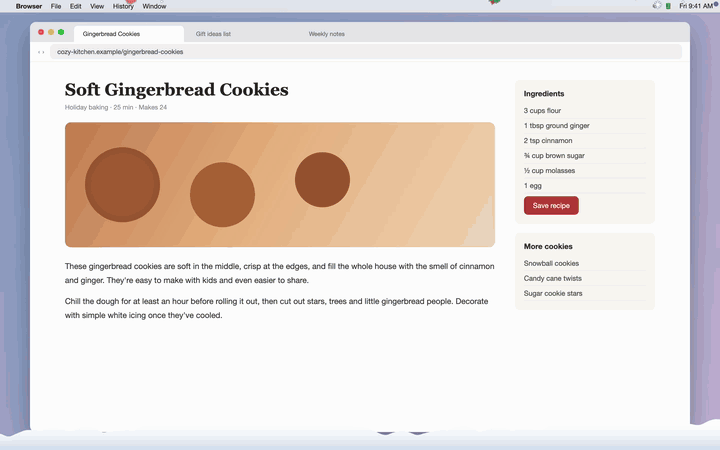

# ❄️ Xmas Snow

Pixel-art Christmas snow that falls across the top of your screen — with candy canes, gingerbread cookies and gift boxes mixed in, and Santa, a snowman, a penguin and shooting stars passing by now and then.

It sits on top of everything but never blocks your clicks, so you can keep working while it snows.


Set the snow height to **1/8** and it stays in a thin strip along the top while you work — everything underneath still takes your clicks:



## What it does

- **Pixel snowflakes** that sway left and right as they fall
- **Falling treats** mixed into the snow: candy cane 🍬, gingerbread 🍪, star ⭐, ornament 🔴, mistletoe 🌿, bell 🔔, gift box 🎁
- **Visitors** that pass by every few minutes: Santa's sleigh 🎅, a hopping snowman ⛄, a sliding penguin 🐧, shooting stars 🌠. Santa also tells you how many days are left until Christmas
- **Click things!**
  - Santa, the snowman or the penguin → a *"Merry Christmas!"* bubble and a shower of gifts
  - A shooting star → *"Your wish will come true!"* ✨
  - A falling treat → it pops into pixel confetti
  - The snow pile (or Rudolph) → Santa drives by in a snowplow 🚜 and clears it
- **Snow piles up** in soft, lumpy drifts along the bottom of your screen — behind the Dock on macOS, just above the taskbar on Windows. Less snow or a lower snow height means it piles up more slowly. Once it reaches its full height it stays there, and Rudolph peeks in from the right edge to ask *"Time to clear the snow?"*
- A few **little Christmas stories** are hidden in there too. When Rudolph peeks in, **click him 5 times quickly** and he'll tell you one 🤫 — and the ❄︎ menu keeps a storybook for anyone who opens it with the right key held down (psst: ⌥ on Mac, Shift on Windows) 📖
- Works across **multiple monitors** — Santa flies from one screen to the next
- Light on resources: under 1% of total CPU on an M1 Mac (about 6–7% of one core) and about 27 MB of memory

## Menu

Click ❄︎ in the menu bar (macOS) or right-click the ❄ tray icon (Windows):

| Menu | Options |
|---|---|
| Snow amount | Light / Normal / Heavy |
| Snow height | 1/8 / 1/5 / 1/3 / 1/2 / Full screen (measured from the top) |
| Fall speed | Slow / Normal / Fast |
| Falling treats | Turn each treat on or off |
| Snow piles up | Turn the snow pile on or off. Click the pile any time to clear it |
| Visitors | Turn Santa / Snowman / Penguin / Shooting star on or off |
| Santa speed | Slow / Normal / Fast |
| Call now | Summon any visitor or the snowplow right away |
| Check for updates… | See if a newer version is out |
| Update to vX.Y.Z | Appears at the top when a new version is out — click to install it and restart |
| Stop snow (Quit) | |

Your choices are remembered.

**Updates**: about once every 12 hours the app asks GitHub for the latest release version (nothing else is sent). If there's a newer one, an *Update* item appears at the top of the menu. Clicking it downloads the release zip from this repository, swaps it in and restarts the snow.

## Install

Grab the zips from the [latest release](../../releases/latest).

### macOS (13 Ventura or later, Apple Silicon and Intel)

1. Unzip `XmasSnow-mac.zip` and move `XmasSnow.app` to Applications (optional).
2. The app is not notarized by Apple, so the first launch is blocked:
   - **macOS 15+**: try to open it once, close the warning, then go to **System Settings → Privacy & Security** and click **Open Anyway**.
   - **macOS 13–14**: right-click the app → **Open** → **Open**.
3. A ❄︎ appears in the menu bar. There is no Dock icon.

### Windows (10 / 11, nothing to install)

1. Right-click `XmasSnow-windows.zip` → **Extract All** (don't run it from inside the zip).
2. Double-click `XmasSnow.bat`. If SmartScreen appears, click **More info → Run anyway**.
3. A console window flashes and closes — that's normal. A few seconds later the snow starts and a "Xmas Snow is running" notification pops up. A ❄ icon appears in the system tray (click ^ if it's hidden).
4. If nothing happens, run `XmasSnow-debug.bat` instead — it keeps a console open so you can see the error (it's also saved to `error.txt`).

The Windows version is a single PowerShell script (`snow.ps1`) that compiles a small C# WinForms program at launch — you can read every line before running it.

## Build from source (macOS)

```sh
./build.sh          # → XmasSnow.app (universal, macOS 13+, ad-hoc signed)
open XmasSnow.app
```

Requires the Xcode command line tools (`swiftc`). Everything is in one file, `snow.swift` — no dependencies.

`XmasSnow.app/Contents/MacOS/snowfall --stage` plays the demo shown above (it paints a solid night-sky background so nothing behind it gets recorded). `--stage-desk <image>` plays the second one on top of a picture of your choice, with the snow height at 1/8.

## How it works

- **macOS**: transparent, borderless `NSPanel`s at status-bar level on every screen. They ignore the mouse except while the cursor is over Santa, a visitor or a treat, so clicks reach your other apps. Each flake is a `CALayer` with a keyframe path, so animation runs in Core Animation rather than on the CPU.
- **Windows**: a layered, click-through, top-most WinForms window per monitor, drawn with GDI+ on a 30 fps timer. Clicks on sprites are detected by polling the mouse button.
- All sprites are tiny character grids (e.g. `"..RWWR.."`) turned into pixel art at runtime.

Code comments are in Korean. Issues and PRs in any language are welcome.

## License

[MIT](LICENSE)
