# ❄️ Xmas Snow

Pixel-art Christmas snow that falls across the top of your screen — with candy canes, gingerbread cookies and gift boxes mixed in, and Santa, a snowman, a penguin and shooting stars passing by now and then.

It sits on top of everything but never blocks your clicks, so you can keep working while it snows.


Set the snow height to **1/8** and it stays in a thin strip along the top while you work — everything underneath still takes your clicks:


## Meet the cast

Everything is tiny pixel art, and almost everything does something when you click it.

### ❄️ Falling from the sky

<table>
<tr><td align="center"></td><td><b>Snowflakes</b><br>Little pixel flakes that sway left and right on the way down.</td></tr>
<tr><td align="center">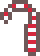 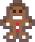 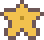 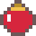 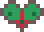 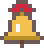 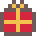</td><td><b>Falling treats</b><br>Candy canes, gingerbread, stars, ornaments, mistletoe, bells and gifts drift down with the snow. Click one and it pops into pixel confetti 🎉</td></tr>
<tr><td align="center">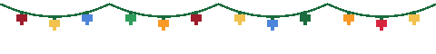</td><td><b>Christmas lights</b><br>A string of lights along the top of the screen. Every bulb twinkles in its own time 💡</td></tr>
</table>

### 🛷 Passing by

<table>
<tr><td align="center">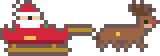</td><td><b>Santa</b><br>Flies across every few minutes — from one monitor to the next — and tells you how many days are left until Christmas. Click him for a shower of gifts 🎁</td></tr>
<tr><td align="center">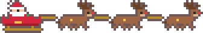</td><td><b>Santa's whole team</b><br>On Christmas Eve he brings three reindeer and comes by a lot more often 🎅</td></tr>
<tr><td align="center">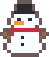</td><td><b>Snowman</b><br>Hops by now and then. Click to say hi.</td></tr>
<tr><td align="center">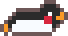</td><td><b>Penguin</b><br>Slides past on its belly, kicking up snow 🐧</td></tr>
<tr><td align="center"></td><td><b>Shooting star</b><br>Gone in two seconds — click it in time and <i>your wish will come true</i> ✨</td></tr>
</table>

### ⭐ Rare visitors — catch them all

They show up only once in a while. Click one to add it to <b>❄ → Rare finds</b>.

<table>
<tr><td align="center"></td><td><b>Golden snowflake</b><br>About one in every 600 falling treats.</td></tr>
<tr><td align="center">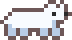</td><td><b>Polar bear</b><br>Takes its time. A lot of time 🐻</td></tr>
<tr><td align="center">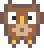</td><td><b>Little owl</b><br>Flutters across, bobbing up and down 🦉</td></tr>
<tr><td align="center">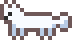</td><td><b>Arctic fox</b><br>Bounds by from the right 🦊</td></tr>
<tr><td align="center">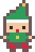</td><td><b>Little elf</b><br>Skips along on an errand for Santa 🧝</td></tr>
</table>

### ⛄ Snowmen you build

<table>
<tr><td align="center"></td><td><b>Press and hold the snow pile</b><br>A snowball appears — keep holding and it rolls bigger: snowball → two tiers → a full snowman with a hat. Let go whenever you like the size. Up to three at a time.</td></tr>
<tr><td align="center">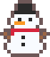</td><td><b>They're alive</b><br>Your snowmen blink, follow your cursor with their eyes and wave when you come close. Build two and they'll chat with each other. When the snowplow comes, they shout <i>“Not me!!”</i> and hop right over it.</td></tr>
<tr><td align="center">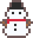 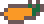</td><td><b>Find a nose</b><br>New snowmen are missing their carrot. Every so often one turns up in the snow — click it and it flies to the nearest snowman 🥕</td></tr>
<tr><td align="center">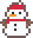 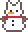 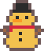</td><td><b>Special snowmen</b><br>About one in ten full snowmen comes out wearing a Santa hat or cat ears — or made of gold. They count as rare finds too.</td></tr>
<tr><td align="center"></td><td><b>Melting</b><br>Press and hold a snowman and it says goodbye and melts into a puddle 💧 (or ❄ → Melt all snowmen)</td></tr>
</table>

### 🏔 At the bottom of the screen

Snow piles up in soft, lumpy drifts — behind the Dock on macOS, just above the taskbar on Windows. Less snow or a lower snow height means it piles up more slowly.

<table>
<tr><td align="center">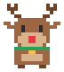</td><td><b>Rudolph</b><br>When the pile is full he peeks in from the right: <i>“Time to clear the snow?”</i> Click him <b>5 times quickly</b> and he'll tell you a secret 🤫</td></tr>
<tr><td align="center">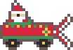</td><td><b>Santa's snowplow</b><br>Click the pile (or Rudolph) and Santa drives by and clears it all away 🚜</td></tr>
<tr><td align="center"></td><td><b>Christmas morning</b><br>On December 25 a row of gifts is waiting on the snow. Click to open them.</td></tr>
</table>

### 🗓 And a few more

- 🎁 **Advent calendar** — from December 1 to 25, open a new door in the ❄ menu each day for a little message and a surprise
- 🎆 **New Year's** — fireworks and *Happy New Year!* in the first minutes of January 1
- 📖 **A little story** — short Christmas tales in the ❄ menu (one pops up the first time you launch)
- 🙈 **Hide for 30 minutes or 1 hour** when you need a clear screen
- Works across **multiple monitors**, and it's light: under 1% of total CPU on an M1 Mac and about 27 MB of memory

## Menu

Click ❄︎ in the menu bar (macOS) or right-click the ❄ tray icon (Windows):

| Menu | Options |
|---|---|
| Snow amount | Light / Normal / Heavy |
| Snow height | 1/8 / 1/5 / 1/3 / 1/2 / Full screen (measured from the top) |
| Fall speed | Slow / Normal / Fast |
| Falling treats | Turn each treat on or off |
| Snow piles up | Turn the snow pile on or off. Click the pile any time to clear it |
| 💡 Christmas lights | Turn the lights along the top on or off |
| 🙈 Hide for… | Hide everything for 30 minutes or 1 hour (*Show snow now* brings it back early) |
| ⭐ Rare finds | The rare visitors and special snowmen you've found so far |
| 💧 Melt all snowmen | Melt every snowman you've built |
| 🎁 Advent calendar | Open today's door, December 1–25 |
| Visitors | Turn Santa / Snowman / Penguin / Shooting star on or off |
| Santa speed | Slow / Normal / Fast |
| Call now | Summon any visitor or the snowplow right away |
| A little story | A short Christmas tale — a different one each time (one pops up by itself the first time you launch) |
| Check for updates… | See if a newer version is out |
| Update to vX.Y.Z | Appears at the top when a new version is out — click to install it and restart |
| Stop snow (Quit) | |

Your choices are remembered.

**Updates**: about once every 12 hours the app asks GitHub for the latest release version (nothing else is sent). If there's a newer one, an *Update* item appears at the top of the menu. Clicking it downloads the release zip from this repository, swaps it in and restarts the snow.

## Install

Grab the zips from the [latest release](../../releases/latest).

### macOS (13 Ventura or later, Apple Silicon and Intel)

1. Unzip `XmasSnow-mac.zip` and move `XmasSnow.app` to Applications (optional).
2. The app is not notarized by Apple, so the first launch is blocked:
   - **macOS 15+**: try to open it once, close the warning, then go to **System Settings → Privacy & Security** and click **Open Anyway**.
   - **macOS 13–14**: right-click the app → **Open** → **Open**.
3. A ❄︎ appears in the menu bar. There is no Dock icon.

### Windows (10 / 11, nothing to install)

1. Right-click `XmasSnow-windows.zip` → **Extract All** (don't run it from inside the zip).
2. Double-click `XmasSnow.bat`. If SmartScreen appears, click **More info → Run anyway**.
3. A console window flashes and closes — that's normal. A few seconds later the snow starts and a "Xmas Snow is running" notification pops up. A ❄ icon appears in the system tray (click ^ if it's hidden).
4. If nothing happens, run `XmasSnow-debug.bat` instead — it keeps a console open so you can see the error (it's also saved to `error.txt`).

The Windows version is a single PowerShell script (`snow.ps1`) that compiles a small C# WinForms program at launch — you can read every line before running it.

## Build from source (macOS)

```sh
./build.sh          # → XmasSnow.app (universal, macOS 13+, ad-hoc signed)
open XmasSnow.app
```

Requires the Xcode command line tools (`swiftc`). Everything is in one file, `snow.swift` — no dependencies.

`XmasSnow.app/Contents/MacOS/snowfall --stage` plays the demo shown above (it paints a solid night-sky background so nothing behind it gets recorded). `--stage-desk <image>` plays the second one on top of a picture of your choice, with the snow height at 1/8.

## How it works

- **macOS**: transparent, borderless `NSPanel`s at status-bar level on every screen. They ignore the mouse except while the cursor is over Santa, a visitor or a treat, so clicks reach your other apps. Each flake is a `CALayer` with a keyframe path, so animation runs in Core Animation rather than on the CPU.
- **Windows**: a layered, click-through, top-most WinForms window per monitor, drawn with GDI+ on a 30 fps timer. Clicks on sprites are detected by polling the mouse button.
- All sprites are tiny character grids (e.g. `"..RWWR.."`) turned into pixel art at runtime.

Code comments are in Korean. Issues and PRs in any language are welcome.

## Also

Use the [Clawd on Desk](https://github.com/rullerzhou-afk/clawd-on-desk) desktop pet? There are matching Christmas pixel themes — a snowman, Rudolph, gingerbread and a tree — in [Xmas Clawd Themes](https://github.com/imhuijeong92-ui/xmas-clawd-themes) 🎄

## License

[MIT](LICENSE)
