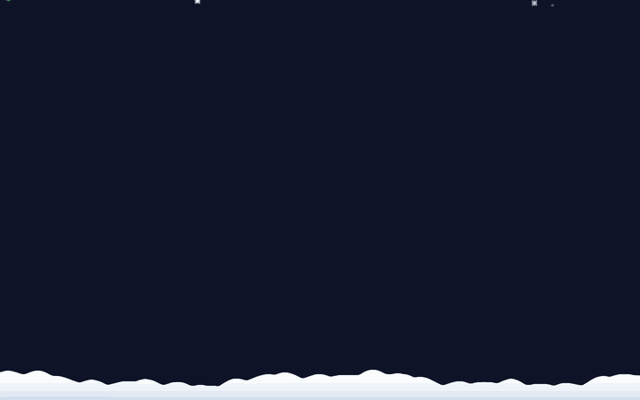

# ❄️ Xmas Snow

Pixel-art Christmas snow that falls across the top of your screen — with candy canes, gingerbread cookies and gift boxes mixed in, and Santa, a snowman, a penguin and shooting stars passing by now and then.

It sits on top of everything but never blocks your clicks, so you can keep working while it snows.



## What it does

- **Pixel snowflakes** that sway left and right as they fall
- **Falling treats** mixed into the snow: candy cane 🍬, gingerbread 🍪, star ⭐, ornament 🔴, mistletoe 🌿, bell 🔔, gift box 🎁
- **Visitors** that pass by every few minutes: Santa's sleigh 🎅, a hopping snowman ⛄, a sliding penguin 🐧, shooting stars 🌠
- **Click things!**
  - Santa, the snowman or the penguin → a *"Merry Christmas!"* bubble and a shower of gifts
  - A shooting star → *"Your wish will come true!"* ✨
  - A falling treat → it pops into pixel confetti
- Works across **multiple monitors** — Santa flies from one screen to the next
- Light on resources: about 4–5% of one CPU core and about 20 MB of memory on an Apple Silicon Mac

## Menu

Click ❄︎ in the menu bar (macOS) or right-click the ❄ tray icon (Windows):

| Menu | Options |
|---|---|
| Snow amount | Light / Normal / Heavy |
| Snow height | 1/5 / 1/3 / 1/2 / Full screen (measured from the top) |
| Fall speed | Slow / Normal / Fast |
| Falling treats | Turn each treat on or off |
| Visitors | Turn Santa / Snowman / Penguin / Shooting star on or off |
| Santa speed | Slow / Normal / Fast |
| Call now | Summon any visitor right away |
| Stop snow (Quit) | |

Your choices are remembered.

## Install

Grab the zips from the [latest release](../../releases/latest).

### macOS (13 Ventura or later, Apple Silicon and Intel)

1. Unzip `XmasSnow-mac.zip` and move `XmasSnow.app` to Applications (optional).
2. The app is not notarized by Apple, so the first launch is blocked:
   - **macOS 15+**: try to open it once, close the warning, then go to **System Settings → Privacy & Security** and click **Open Anyway**.
   - **macOS 13–14**: right-click the app → **Open** → **Open**.
3. A ❄︎ appears in the menu bar. There is no Dock icon.

### Windows (10 / 11, nothing to install)

1. Right-click `XmasSnow-windows.zip` → **Extract All** (don't run it from inside the zip).
2. Double-click `XmasSnow.bat`. If SmartScreen appears, click **More info → Run anyway**.
3. A ❄ icon appears in the system tray (click ^ if it's hidden). The first launch takes a few seconds while it compiles.

The Windows version is a single PowerShell script (`snow.ps1`) that compiles a small C# WinForms program at launch — you can read every line before running it.

## Build from source (macOS)

```sh
./build.sh          # → XmasSnow.app (universal, macOS 13+, ad-hoc signed)
open XmasSnow.app
```

Requires the Xcode command line tools (`swiftc`). Everything is in one file, `snow.swift` — no dependencies.

`XmasSnow.app/Contents/MacOS/snowfall --stage` plays the demo shown above (it paints a solid night-sky background so nothing behind it gets recorded).

## How it works

- **macOS**: transparent, borderless `NSPanel`s at status-bar level on every screen. They ignore the mouse except while the cursor is over Santa, a visitor or a treat, so clicks reach your other apps. Each flake is a `CALayer` with a keyframe path, so animation runs in Core Animation rather than on the CPU.
- **Windows**: a layered, click-through, top-most WinForms window per monitor, drawn with GDI+ on a 30 fps timer. Clicks on sprites are detected by polling the mouse button.
- All sprites are tiny character grids (e.g. `"..RWWR.."`) turned into pixel art at runtime.

Code comments are in Korean. Issues and PRs in any language are welcome.

## License

[MIT](LICENSE)
